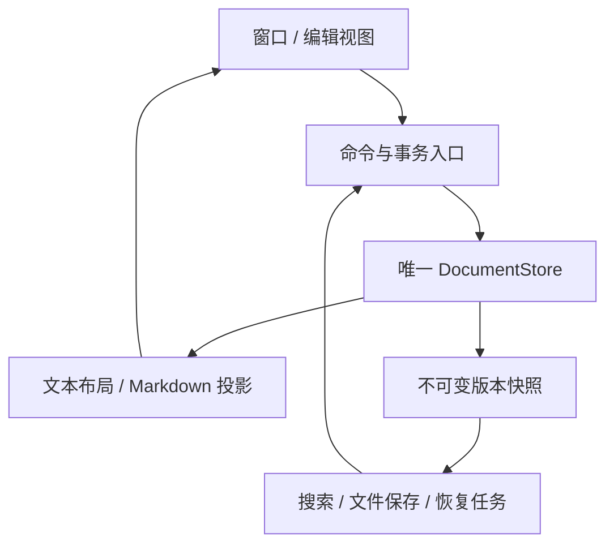

# texzi 技术设计 v1

状态：可供实施的设计基线，尚未实现或完成 Windows 实机验证。日期：2026-11-15。

本文件解释实现路径和工程约束；产品规则以 [PRD.md](PRD.md)、交互以 [UI_SPEC.md](UI_SPEC.md) 为准，测量方法以 [PERFORMANCE_PLAN.md](PERFORMANCE_PLAN.md) 为准，任务依赖见 [HANDOFF.md](HANDOFF.md)。所有“建议”“工程默认值”均为本方案的选择，不伪装为用户原话；“待验证”不等于已经支持。

## 1. 已确认的方向与技术基线

| 项目 | 基线与证据性质 |
|---|---|
| 产品 | texzi；Windows 原生日常文本编辑器；临时文本、Markdown、代码片段；不做完整 IDE 或插件生态。用户已确认。 |
| 架构 | **Windows x64**。此前讨论过的 x86/32 位风险已不适用，不得继续把 x86 当交付目标。 |
| 最低系统 | 用户要求 Windows 10。**Windows 10 1809+ x64 为本方案建议的工程最低版本**，依据 NSH 文档；主要验收环境为 Windows 10 22H2 x64。1809 必须单独兼容性验证，不得把在 22H2 通过写成已验证全部 Windows 10。 |
| NSH | 固定 `v0.5.1`，commit `224d9a795c7ac9d10d75750de9351adac5549675`。后续修补须记录 texzi fork 的 commit 及补丁清单。 |
| 编辑形式 | Markdown 默认真正 WYSIWYG；正文右上 `>_` 在同一编辑区域切源码；切换不修改文本、不增加撤销记录；原文为唯一事实源。 |
| 多视图 | 同文档跨分屏、跨窗口共享内容、脏状态和唯一历史；每个视图独立保留模式、选区、折叠与滚动。 |
| 专注模式 | Z 已澄清为 Zen，属于窗口呈现状态，不复制文档、不建立另一个保存对象。 |
| 性能 | 用户接受的指标见性能文件。NSH 的架构和官方演示不构成 texzi 达标证据。 |
| 隐私行为 | 不主动识别、分类或判断输入是否为敏感文本。恢复、缓存、保存策略对所有文本一致；诊断日志默认不记录正文。 |

一手依据：[NSH v0.5.1 发布](https://github.com/longbridge/nsh/releases/tag/v0.5.1)、[固定 commit](https://github.com/longbridge/nsh/commit/224d9a795c7ac9d10d75750de9351adac5549675)、[Windows 后端及最低系统](https://nsh.dev/docs/windows/)。

### 1.1 NSH 的定位及不能直接推导的能力

NSH 是 Native Shell 原生 UI 框架，并非因为关联 GPUI 项目就必然使用 GPUI 渲染。其 Windows 后端采用 Win32 窗口、Direct2D 绘制和 DirectWrite 文本布局；支持 Rust 应用及 JS/TSX 应用。这里的“原生”包含原生窗口/二进制/绘制链，但多数控件由 NSH 自绘，不能理解成所有控件都是 Windows 系统控件。texzi 建议使用 **Rust 应用 + NSH Windows 后端**，不为主编辑器引入浏览器运行时。WebView2 是 NSH 使用 WebView 时的依赖，不是本方案原生 Markdown 编辑的前提。[固定 Windows 后端说明](https://github.com/longbridge/nsh/blob/v0.5.1/docs/dev/windows.md)、[固定平台依赖及 feature](https://github.com/longbridge/nsh/blob/v0.5.1/crates/nsh-platform-windows/Cargo.toml)。

建议显式关闭默认 feature，仅启用项目需要的 `editor`、`rich-editor`、`highlight`；公式若列入产品支持范围，再启用 `math`。不启用终端、图表、shader 或 JS 只是当前裁剪决定，不保证 Windows 平台 Cargo 依赖中完全没有 WebView 相关代码。安装包必须检查实际链接及随包文件，不能只据 feature 名推算体积。NSH 固定 workspace 声明 Rust 1.97、edition 2024、Apache-2.0；需使用可实际安装且匹配的工具链锁文件，携带适用的第三方许可，包括 RichEditor 移植部分的上游声明。[固定 Cargo.toml](https://github.com/longbridge/nsh/blob/v0.5.1/Cargo.toml)、[RichEditor 说明](https://github.com/longbridge/nsh/blob/v0.5.1/docs/dev/rich-editor.md)。

| 能力 | 固定版本已有事实 | texzi 仍须完成 |
|---|---|---|
| 纯文本/代码 Editor | Rope 缓冲、可见行窗口、多光标、选区、折叠、搜索及高亮；默认搜索上限 10,000，撤销上限 1,000 步；字符宽度求和，未实现连字及字距调整。 | 增量文档适配、产品快捷键、共享历史、独立视图、字体及中文测试、搜索服务替换、性能证明。 |
| RichEditor | Schema、节点/mark、事务、history、输入规则及原生视图，Markdown 导入导出。 | 无损原文桥接、局部 patch、每视图状态、虚拟化/复杂度治理；不能用整篇导入导出同步文档。 |
| Markdown 保真 | `MarkdownFormat::is_lossless_for` 明确返回 `false`，整体序列化会规范化空白、结构及结尾换行。 | 未改片段字节保留；未知语法 opaque 节点；富编辑操作仅改必要源区间。 |
| 中文输入 | Windows 后端有基于 RichEdit/TSF 的输入桥接及 UTF-16 协议。 | Pinyin/Sogou、候选窗位置、组合期间切换、撤销边界、混合 DPI 实测。 |
| 多窗口/分屏 | Native Window、Dock/Resizable 及布局能力存在。 | 文档 ownership、关闭策略、拖出窗口、恢复及多显示器坐标治理。 |
| 大文件 | Editor 有 Rope 和可见行渲染，不等于所有上层事件都增量；RichEditor 尚不能视作已证明大文档虚拟化。 | 避免每键全量字符串、后台任务有界、长行策略、100 MiB 实测，富编辑单列范围。 |

依据：[Editor 固定设计说明](https://github.com/longbridge/nsh/blob/v0.5.1/docs/dev/editor.md)、[Editor buffer](https://github.com/longbridge/nsh/blob/v0.5.1/crates/nsh-base/src/editor/buffer.rs)、[Markdown 格式实现](https://github.com/longbridge/nsh/blob/v0.5.1/crates/nsh-base/src/rich_editor/formats/markdown.rs)、[Windows 输入桥接](https://github.com/longbridge/nsh/blob/v0.5.1/crates/nsh-platform-windows/src/text_input.rs)、[Dock](https://nsh.dev/elements/dock/)、[桌面窗口 API](https://nsh.dev/modules/nsh-desktop/)。

## 2. 模块边界与运行模型

下列 crate 名为拟定的实施接口，可以在 T00 统一调整一次；调整不改变责任边界。

| 模块 / 建议 crate | 拥有的数据 | 职责与不得越界事项 |
|---|---|---|
| `texzi-document` | DocumentStore、Rope、EOL 表、版本、历史、源区间映射 | 所有正文写入的唯一入口；不依赖 HWND 或具体视图。 |
| `texzi-editor-adapter` | 文本视图局部布局、光标、可见行缓存 | NSH Editor 的输入/绘制接口；提交事务，不私自持有另一份可独立修改的正文历史。 |
| `texzi-markdown` | CST/块索引、SourceMap、富编辑投影、正文搜索投影 | 从原文派生视图，将富编辑动作转换成局部源事务；禁止整篇 serialize 回写。 |
| `texzi-search` | 查询、不可变快照引用、匹配页、取消 token | 字面检索和 PCRE2 调度、替换计划；不直接修改正文。 |
| `texzi-files` | 路径身份、文件指纹、保存任务、watcher | 解码、编码、原子替换、外部变更；正文变更仍经 DocumentStore。 |
| `texzi-recovery` | 检查点与事务日志、会话清单 | 崩溃恢复；不充当第二份实时可编辑模型。 |
| `texzi-workspace` | Window/Group/View 布局树、文件夹树、最近项 | 窗口、分屏、标签及文件夹导航；不由文件树扫描决定文档是否仍存在。 |
| `texzi-commands` | 命令注册、快捷键条件、配置 schema | 所有入口调用同一命令，避免菜单、键盘、鼠标三套语义。 |
| `texzi-app` | NSH app、主题、交互状态、平台事件 | 组装各模块、窗口绘制、状态提示。 |
| `texzi-bench` / `xtask` | 场景、时序、样本 manifest | 可重复性能与故障注入；不把测试工具放进默认启动关键路径。 |



**单写者原则。** NSH 固定 Windows 实现中，引擎线程与 Win32 UI/绘制线程是分开的：引擎提交批次，经唤醒消息由 UI 线程挂载/绘制。texzi 建议 DocumentStore 的唯一写者位于引擎线程；Win32 线程接收系统/TSF消息、维护平台焦点与候选几何，向写者投递输入意图，渲染消费不可变快照及有序 delta，不直接修改正文。若具体 NSH 适配要求独立 DocActor，也必须保留单写者与明确消息顺序，不能把一个 Mutex 长时间占在 UI 线程。[固定线程模型](https://github.com/longbridge/nsh/blob/v0.5.1/docs/dev/windows.md)。

线程池负责文件 IO、解码、索引、高亮、Markdown 重解析和恢复写盘。每项任务携带 `DocId + Revision + CancelToken`；返回后版本不匹配则丢弃或重算，不能覆盖用户后来输入。线程池建议 2 个 CPU 工作线程起步，IO 独立队列；优先级为当前输入/首屏、当前查询、后台索引、非活动标签。避免每个标签各开一个无界线程。复杂正则使用按需启动的专用进程，超时可终止，进程启动不占应用首次启动路径。

大范围替换、加载及重建先在后台创建候选快照，再在文档写者线程以一次指针/版本交换提交，经批次通知 UI；不得在 UI 或引擎前台路径循环应用百万个编辑。任务队列有背压：同一文档旧的高亮/投影请求可取消合并，但不能丢弃已接受的文本事务。

## 3. 规范数据模型与事务协议

### 3.1 唯一正文与三类坐标

文档权威状态由 **逻辑原文 Rope + 逐换行 EOL 表 + 编码/BOM 元数据**组成。Rope 内部使用 UTF-8、逻辑换行 `LF`，这不是保存时统一换行的许可；原文件每个 CRLF/LF/CR 边界在 EOL 表保留，混合换行按原位置回写。原始字节区间只作不可变来源与未改片段保存依据，不建立第二个可编辑模型。Markdown 的完整标记、未知语法、空白和尾部换行状态均属于这份原文。

三类坐标必须显式区分：`SourceByte` 为规范 Rope 的 UTF-8 字节偏移；Windows/TSF 边界使用 UTF-16 code unit；UI 移动/删除按 grapheme cluster。Markdown 节点位置是第四种派生坐标，必须经 SourceMap 转换，禁止直接将 JS 字符串长度、UTF-16、字节索引混用。转换缓存按行/块维护，不能每键从文件头扫描。

```rust
// 设计伪码；不是已存在的 NSH API。
struct Document {
    id: DocId,
    source: Rope,                    // 唯一可编辑原文，逻辑 LF
    eols: LineEndingMap,              // 每个逻辑换行的原始类型
    encoding: EncodingProfile,       // code page / BOM / strict policy
    provenance: OriginalByteSpans,    // 未改段的原始字节来源
    revision: Revision,
    history: TransactionHistory,
    saved_state: SavedStateToken,     // 可识别撤销回到已保存状态
    disk: Option<FileIdentityAndFingerprint>,
    save_status: SaveStatus,
}
struct ViewState {
    id: ViewId, doc: DocId, window: WindowId, group: GroupId,
    mode: PlainOrSourceOrWysiwyg,
    selection: SelectionSet,         // 每视图拥有，不存到共享 rich session
    scroll: SourceAnchorAndPixelBias,
    folds: FoldState,
    composition: Option<CompositionState>,
}
struct EditTxn {
    doc: DocId, base_revision: Revision, origin: ViewIdOrService,
    edits: Vec<SourceEdit>,          // 不重叠，UTF-8 边界合法
    eol_delta: EolDelta,
    selection_before: SelectionSnapshot,
    selection_after: SelectionSnapshot,
    kind: TypingOrImeOrPasteOrReplaceOrRichCommand,
    history_group: HistoryGroupId,
}
trait DocumentApi {
    fn snapshot(doc: DocId) -> DocumentSnapshot;
    fn submit(txn: EditTxn) -> Result<CommitReceipt, ConflictOrInvalidEdit>;
    fn undo(doc: DocId, invoking_view: ViewId) -> Result<CommitReceipt, Error>;
    fn subscribe(doc: DocId) -> Stream<DocumentDelta>;
}
```

`submit` 顺序：验证版本与偏移 → 合并重复/相交选区及确定替换顺序 → 生成逆操作及 EOL/来源映射变化 → 应用持久化缓冲变更 → 版本加一 → 将所有视图锚点映射到新版本 → 发布增量事件 → 异步派生高亮/投影/恢复。冲突版本不自动猜测用户意图；交互小动作在最新版本重算，后台 Replace All 要明确重新检索。

### 3.2 撤销、脏状态和选区

每个 Document 只有一条按时间排序的内容历史。纯文本输入、富编辑命令、IME 一次确认、粘贴、替换全部、换行转换均通过它；禁止保留两套互不关联的 NSH Editor/RichEditor undo 栈。切模式、滚动、切主题和普通选择不产生内容 undo。连续同位置输入可以按时间/动作分组；跨视图编辑、光标导航、保存边界、IME composition 结束及结构化命令结束必须终止当前合并组。工程建议最多 750 ms 连续输入窗口，最终与 PRD 保持一致。

历史记录保存正反 delta 与发起视图的选区快照；其他视图仅映射锚点，不被迫跳到正在编辑的位置。共享历史意味着在窗口 B 按 Undo 可以撤销窗口 A 对该文档最近的内容编辑，这是确定行为。调用视图定位到撤销作用区；其他视图保留位置。使用 `SavedStateToken` 判断是否回到保存状态，不能以“revision 不等于上次保存 revision”永久判脏，也不能每键全文件 hash。异步保存捕获 revision `r`，写盘完成只能把 `r` 标为已保存；当前已到 `r+1` 时继续显示未保存。

建议历史内存软预算为每文档 64 MiB、全进程 256 MiB，超过后将较老组压缩/转移到本地历史段文件，或按明示的会话历史边界回收；不得分割一个事务导致只撤销一半。预算属于工程建议，需用大粘贴与 Replace All 压测后锁定，不沿用 NSH 的 1,000 步上限而不说明。

## 4. NSH 纯文本适配与大文件路径

### 4.1 必须实现的增量接口

NSH Editor 的受控 `value/onChange` 适合小文本，但固定实现会按版本创建整篇共享字符串。对于 10–100 MiB 文档，不能每键构造完整字符串，再交回另一个组件作为 `value`。应在最小 fork 或上游贡献中增加：外部缓冲读接口、增量修改回调、外部历史控制、每视图 selection/scroll、可见行布局读取。DocStore 与 NSH 可以共享持久化 Rope 快照/缓冲 trait，不能各自维护两个可以写的正文。建议接口：`bind_document(handle)`、`on_transaction(delta)`、`apply_external_delta(delta)`、`set_selection(view, anchors)`、`visible_range()`。[固定 Editor 实现说明](https://github.com/longbridge/nsh/blob/v0.5.1/docs/dev/editor.md)、[state.rs](https://github.com/longbridge/nsh/blob/v0.5.1/crates/nsh-base/src/editor/state.rs)。

语法高亮采用固定版本已有的逐行增量能力，按可见区优先、可取消的后台批次运行。语言集合由 PRD 列出的首版集合确定；未知语言纯文本显示，不创建语言服务器。禁止为满足“像 VS Code”自行添加 LSP、补全服务、调试器或终端。

### 4.2 文件规模策略

| 条件（工程默认，可设置的阈值以设置表为准） | 策略 | 能力边界 |
|---|---|---|
| <20 MiB 且结构普通 | 正常编辑；可见区先高亮，按需建索引。 | 1/10 MiB 是本方案展开的主要样本；延用已接受输入目标，纯文本与 Markdown 模式分别记录，具体模式矩阵属于设计建议。 |
| ≥20 MiB | 显示“大文件优化”状态；渐进加载、延迟非必要高亮/全局布局、关闭昂贵装饰。 | 不自动只读；保存、编辑、撤销、查找仍可用；策略变化可见。 |
| 100 MiB、普通行长文本 | 完整缓冲后台建立；首屏优先；达到可编辑状态后位置映射/保存/撤销均正确。 | 首屏≤2 s、可编辑≤5 s 适用于纯文本及 Markdown 源码；不把它扩展成任意富文档承诺。 |
| 达到 `performance.longLineThresholdChars`（建议默认 ≥20,000 Unicode scalar），或文件包含极长 token | 可见横向片段布局；换行测量分段；暂缓该行高亮并提示；≥1 MiB 单行另作强压力样本。 | 不截断内容；选择到行尾、复制、保存仍作用于完整行。 |
| 富文档 ≥20 MiB，或 >50,000 块，或单表 >10,000 单元格，或单块 >1 MiB | 可取消的富编辑准备过程；块级索引/虚拟化；提供用户可主动选择的“先在源码中编辑”。 | 仍以真正 WYSIWYG 为实现目标；不得静默变成只读预览。阈值为建议，经 Gate 测试后锁定。 |
| 达到超大文件设置阈值（建议默认 ≥200 MiB）；1 GiB、超深嵌套、巨表、极长行另作探索 | 先做资源预估，提供清楚标明的只读流式查看与尝试编辑选项；内存不足时明确失败。 | 不承诺 100 MiB 相同时间；不得崩溃或损坏原文件；不能宣称无限大文件。 |

普通行长定义及 fixture 见性能文件。20 MiB 是策略阈值，不是支持上限。编辑不可在只加载前缀时伪装 ready；若采用分块可编辑实现，必须证明未加载区域索引、替换、保存与撤销均正确，否则先完成全文件模型再开放编辑。大文件避免将每个字符/语法 token 建成独立 UI 元素。

## 5. 真正 WYSIWYG 与源码保真的实现

quiet.md 的实际编辑、文件写回及 Windows 能力已另附 [参考产品核实](REFERENCE_RESEARCH.md)。它是 Rust+GPUI 应用，可借鉴交互和部分算法，但不是可直接安装的 NSH 富编辑组件；本节继续采用 NSH RichEditor 与 texzi 自己的源文本桥接。

### 5.1 为什么不能直接连 `getMarkdown()` 与 `setContent()`

NSH RichEditor 可执行真实富编辑，但其 Markdown serializer 是格式转换器，不是源码保真编辑器；空白、标记形式及不支持的结构可能被改变。`setContent` 是内容替换操作，不能作为每次切换模式的同步手段。固定 session 还混合持有 selection、历史及视图几何信息，需要拆出每视图状态。此处是首版主要工程风险，不由概念图解决。[MarkdownFormat 源码](https://github.com/longbridge/nsh/blob/v0.5.1/crates/nsh-base/src/rich_editor/formats/markdown.rs)、[session.rs](https://github.com/longbridge/nsh/blob/v0.5.1/crates/nsh-base/src/rich_editor/view/session.rs)、[RichEditor 开发说明](https://github.com/longbridge/nsh/blob/v0.5.1/docs/dev/rich-editor.md)。

### 5.2 源码保真桥接层

`MarkdownBridge` 维护四种派生数据：带完整 token/空白区间的 CST、稳定 BlockId 树、`SourceMap`、RichEditor 投影。AST 单独不足以保留 Markdown 原貌，因此解析时必须保留标记、缩进、空行、转义、链接定义、fence 长度、列表标记及未理解的片段。初始可复用固定 NSH 已用 Markdown parser 的位置数据，并补充无损 token/trivia 层；若它不能提供可靠边界，则在 T05 引入经过固定版本/许可审查的 CST parser。新增 parser 的版本在 Gate 锁定，不虚构当前依赖版本。

富编辑步骤如下：

1. 从发起视图取得基于 revision 的选择及 RichEditor step；将节点位置映射到源码范围。
2. 普通文字增删、勾选任务、编辑链接标签等使用专门的源 patch handler，只改目标字符/定界符；不先序列化整个块。
3. 拆分段落、合并列表项、增删表格行等结构动作扩张到“能安全重写的最小祖先区间”。区间外源字节与 EOL 不变；区间内尽量延续原来的列表符号、fence 与缩进风格。
4. 验证候选 patch 的解析结构与意图一致，特别是 `*`、`_`、反引号、方括号转义。不能准确映射时，停止该富编辑动作并提供局部源码编辑，不得猜测后覆盖全文。
5. 提交一个 `EditTxn`，通过同一历史生成逆操作；重新解析受影响块及必要相邻区域，更新 SourceMap，映射所有视图锚点。

引用式链接定义、列表延续、未闭合 fence 可能影响远处语义；“增量”不能理解成永远只解析当前行。维护全局定义索引，遇到边界不收敛时后台扩大重解析范围，旧投影可暂时显示“更新中”，但不能用旧坐标接受会误改文本的操作。单次超出预算的结构修改先构建候选版本，取消时不提交任何正文变化。

```rust
// 建议的桥接契约
trait MarkdownBridge {
    fn project(snapshot: &DocumentSnapshot, changed: SourceRanges)
        -> Result<ProjectionDelta, ParseFailure>;
    fn plan_rich_edit(snapshot: &DocumentSnapshot,
        view: &RichViewState, step: RichStep)
        -> Result<EditTxn, RequiresLocalSourceEdit>;
    fn source_to_rich(anchor: SourceAnchor) -> MappedRichAnchor;
    fn rich_to_source(anchor: RichAnchor) -> SourceAnchor;
    fn search_projection(revision: Revision) -> ProjectionTextAndMap;
}
```

### 5.3 首版结构覆盖及未知语法

P0 桥接覆盖段落、标题、粗体/斜体/删除线、引用、有序/无序/任务列表、链接、行内代码、fenced code、水平分隔、GFM 简单表格与图片引用。代码块中的文本真正可编辑，语言标识用于高亮，不运行代码。复杂合并单元格、任意 HTML、脚注扩展、嵌入脚本或未知自定义语法未获实现前，以**原文保留的 opaque 块/内联片段**显示；可以选中、移动、删除及进入局部源码，不把未知节点悄悄扁平化。含 HTML 的文本不作为应用脚本执行；外链打开由显式点击触发。

opaque 不是第二份正文：它指向原文的 source range，经过其他事务自动映射。普通编辑不应重新编码其中的实体或统一其空白。用户显式删除整个 opaque 块是有效操作，Undo 必须恢复完整原始片段。支持的已知结构也必须通过语义往返和未改片段保真测试；仅比较“渲染看起来相同”不能验收。

图片按可见性延迟解码，保留本地相对路径，以 Markdown 文件目录为基准；未保存文档插入资源需明确保存位置。缺失资源显示有尺寸限制的占位、替代文本和重试，不让图片失败阻断正文编辑。远程资源的加载策略由设置统一控制，不因正文内容类型分类。

### 5.4 模式、选择与搜索投影

`>_` 切换过程：完成或取消当前系统 composition → 记录源码锚点/顶部可见块偏移 → 校验投影 revision → 同区域替换视图 → 转换/恢复锚点 → 焦点回编辑器。切换不得产生 `EditTxn`，不变化 dirty，不新增 undo。切回源码时，仅在 Document revision 自离开源码以来未变的情况下恢复此前多选区；发生过编辑则以本次切换的当前源码锚点映射为主，不恢复过期的多光标集合。源区间已删除时落到同一块或最近合法边界，并保持视图可见。多个视图可分别处于富编辑和源码模式，它们共享同一正文。

富编辑默认普通单选区及表格结构选择；请求源码专属多光标动作时，按 PRD 明确提示并原位进入源码，不能只操作主光标却让用户以为多光标有效。纯文本/源码模式支持多光标和多选的完整产品规则。

WYSIWYG 的普通 `Ctrl+F` 查找正文 projection，保持排版：含代码块内容及 opaque 块显示的原文，不含隐藏 Markdown 标记。段落/块间映射为 `\n`，表格 cell 间 `\t`、row 间 `\n`；这些分隔是搜索坐标，不写入原文。映射可以一段正文对应多个不连续源区间，例如格式标记中间的文本；结果以渲染范围高亮。启用 regex 或任何 replace 时，按产品规则原位切源码，清空旧匹配并在原文范围重新查找，明确“已改为搜索 Markdown 源码”。选择范围同样重新映射，不能继续用正文投影的索引替换原始文本。

### 5.5 富编辑大文档 Gate

固定 RichEditor 的部分更新可以复用节点，但当前 `blocks()/each()` 和控制器树遍历不能等同于已证明的可见块虚拟化。先测 1/10 MiB、深列表及巨表，再改造“块高估计 + 可见块挂载 + 稳定锚点 + 局部重测量”。光标所在块、活动 composition 块及选区端点不得在滚动回收中卸载；离屏中间选区用模型范围表示。未通过 Gate 时不交付假 WYSIWYG，也不声称 100 MiB 富编辑达标。[render.rs](https://github.com/longbridge/nsh/blob/v0.5.1/crates/nsh-base/src/rich_editor/view/render.rs)、[controller.rs](https://github.com/longbridge/nsh/blob/v0.5.1/crates/nsh-base/src/rich_editor/view/controller.rs)。

## 6. 查找、正则与替换

### 6.1 统一语义

建议 `SearchService`：普通子串使用可流式线性检索；正则使用 **PCRE2 8-bit + UTF/UCP**。PCRE2 具体发行版、Rust binding 及编译选项在 T00/T09 锁定到可验证版本并记录 license/SBOM，本文不猜版本。NSH 内置 Rust regex 及 10,000 匹配上限不作最终产品语义。PCRE2、VS Code 的编辑器搜索、其工作区搜索和原型 JavaScript RegExp 都不能未经测试视为同一方言。[NSH 搜索边界](https://github.com/longbridge/nsh/blob/v0.5.1/docs/dev/editor.md)、[PCRE2 pattern](https://www.pcre.org/current/doc/html/pcre2pattern.html)、[PCRE2 API](https://www.pcre.org/current/doc/html/pcre2api.html)。

| 选项 | 实施规则 |
|---|---|
| 部分匹配 | 默认字面子串；不隐含前缀或模糊匹配。 |
| 区分大小写 | 关闭时采用固定 Unicode 规则的大小写无关匹配；明确 Unicode 版本、德语 ß/土耳其 I 等测试，不承诺语言学分词。 |
| 全字 | 在匹配两端检查统一词边界谓词。工程定义 word 字符为 Unicode 字母/数字/组合标记/连接标点（General Category L/N/M/Pc），中文连续汉字视为连续词字符；不加入中文语义分词。通过一个服务实现，避免 UI 与引擎各判断一次。 |
| 正则 | UTF/UCP；`^/$` 默认 multiline，`.` 默认不跨逻辑 LF，显式 `(?s)` 可跨行。非法模式给错误位置与消息；不显示成 0 结果。 |
| 仅选区 | 固定进入检索时选区范围并随文档事务映射；多个范围去重；结果必须完整落入范围。选区变化是否重新绑定依 PRD。 |
| 替换模板 | 产品层解析 `$&`/`$0`、`$1…$99`、`${name}`、`$$`；不存在的组阻止执行，存在但本次未参与的组替换为空串。字面替换模式不展开组；换行输入用替换框的多行能力，不额外猜测 `\n`。 |
| 零宽匹配 | 遵循固定的非重叠全局枚举规则；同一位置只报告一次零宽匹配，随后前进一个 Unicode scalar，EOF 零宽最多一次。与其他引擎差异列入帮助及测试。 |

全字规则与正则 `\b` 不是必然等价，正则中的 `\b` 仍按 PCRE2 语义。不区分大小写的字面检索可用引擎的 escaped literal 路径保证和正则模式一致，前提是保持流式能力及源偏移正确；若采用单独 Unicode folding，需要长度变化映射并通过统一语料测试。

### 6.2 资源与事务

界面仅为可见区及邻近区保留建议最多 5,000 个高亮装饰，总匹配结果分页枚举，计数异步更新“已找到 N，仍在搜索”。不能把 10,000 写成全部结果。常见字面查询按 Rope chunk 扫描，跨 chunk 保留查询长度所需边界；跨行正则不能任意按行拆开。复杂正则对固定快照使用连续地址缓冲或只读映射，资源成本计入总内存；大到无法建立合法 subject 时说明限制，不返回错误的部分结果。

PCRE2 的 match/depth/heap 限制与 callout 是防卡死手段，**匹配步数不是毫秒超时**。建议解释器路径先实现并验证可取消性；JIT 只有验证相同预算与结果后才启用。专用 worker 接收查询 ID/revision，250 ms 未完成显示进度，默认 2 s 查询预算到期终止并报告“正则计算超时”，取消 p95 目标≤100 ms。边界条件、可重新运行与预算见性能文件。

Replace All：获取固定版本 → 完整枚举并验证模板/资源 → 生成非重叠 edits 或后台候选 Rope → 检查文档仍为该版本 → 单一事务提交。预计算取消、超时、磁盘不足或版本变化都不提交部分替换。替换中新生成文本不参与同一次匹配。大结果集建议将匹配计划暂存到本地工作文件；资源不可满足则明确失败，不为了完成操作破坏事务原子性。

### 6.3 文件夹搜索

文件夹文本搜索为 P0，跨文件批量替换为 P1。`WorkspaceSearchCoordinator` 只枚举当前根目录，依据包含/排除 glob 与文件链接规则筛选；目录惰性读取，建议最多 2 个并发文件扫描。防止联接/符号链接形成环路，不默认越出根目录。已打开且 dirty 的文件以对应 DocumentSnapshot 替代磁盘文本，并在结果标为“未保存版本”。每个结果携带文件身份、所用 revision/磁盘指纹、源范围和只在需要时读取的行片段；点击时文件已变化则重定位或提示结果过期，不跳到错误字节。

候选文件先做 BOM/严格编码识别，再判断是否适合文本检索；UTF-16 的 NUL 不能直接当二进制证据。无法解码、权限不足、文件过大或预算耗尽都计入跳过清单，并在结果区说明搜索不完整。全局 `search.maxResults` 建议默认 20,000，仅适用于文件夹结果集合；达到上限明确显示“已截断”，不能与单文档分页查找混淆。每文件和总任务均可取消，异步结果按 query_id 防陈旧更新；查询改变后不继续遍历旧目录任务。默认 glob 与可配置范围以 SETTINGS 为准，不读取 `.gitignore` 就声称完全继承开发工具忽略语义。

## 7. 编码、换行与文件保存

### 7.1 解码与编码

P0：UTF-8（有/无 BOM）、UTF-16 LE/BE、GB18030、GBK（Windows 936）、Windows-1252；具体菜单值及默认值见设置表。新文档建议 UTF-8 无 BOM、CRLF；打开文件保留检测出的编码/BOM/EOL。先看 BOM，再严格 UTF-8 校验，其后使用明确编码选择和有置信提示的候选；不能把“可按某代码页解码”当成准确识别。无 BOM UTF-16 与混合/无效字节必须有异常路径。

使用严格 decoder/encoder；错误位置可视化，不静默用 U+FFFD 覆盖原字节后保存。编码不确定时允许选择“以编码重新打开”，未保存修改必须先保存副本/放弃/取消；不能后台覆盖。编码转换独立于“重新打开”，保存前验证所有字符可表示，不可表示时阻止并给出改用 UTF-8 的操作。GB18030 的具体标准映射/实现版本在 T07 锁定，以固定 fixture 往返验证，不依赖机器区域设置。

未改片段可通过 provenance 从原始字节存储透传，避免代码页中等价但不同字节的序列被无意重编码；被修改的片段严格编码。新插入行采用文档主导换行，平票采用文件中的第一个换行，完全没有换行时采用新文件默认值；原有行仍保留自身 EOL。显式“转换为 LF/CRLF”才更新全部 EOL 表且作为一次可撤销操作。保存不默认补末尾换行、去尾空格或格式化，除非用户设置明确开启。

### 7.2 安全保存流程

1. 捕获不可变版本 `r`、目标路径、编码及上次磁盘指纹；UI 显示保存中，可继续输入。
2. 检查目标身份和外部变更状态；存在未解决冲突时先进入冲突流程。
3. 在目标**同一目录/卷**创建随机命名临时文件，严格编码整个快照，计算校验及长度，写入完成后调用 `FlushFileBuffers`。新文件与旧文件的权限/属性策略明确继承并检查失败。
4. 替换前复核身份、大小、修改时间和 watcher 代次；有疑问计算内容 hash。与预期不同则停止自动替换。
5. 已有文件用 `ReplaceFileW` 并保留可恢复备份；新建文件用不覆盖已存在目标的同卷重命名路径。绝不以“截断原文件然后重写”作为失败降级。
6. 检查返回值并重新取得目标文件身份。必要时校验备份的原版本；发生检查与替换之间的并发写入时，把保留的外部版本与当前结果作为冲突呈现，不静默丢弃任一份。
7. 只将版本 `r` 标为保存完成；此后输入仍为 dirty。记录新的指纹，关联自己的 watcher 事件，但不全局忽略一个固定时间段内的外部事件。
8. 在明确保存成功、恢复清单已更新后按保留策略回收旧备份/临时文件。失败时保留已写成的副本和恢复线索，提示具体路径/原因。

Windows 没有这里可直接使用的文件内容 compare-and-swap；检查后仍有竞争窗口。因此“保存前复核 + 保留替换备份 + 事后冲突核验”是本方案可靠性路径，不能宣称排除了全部外部并发。`REPLACEFILE_WRITE_THROUGH` 文档标为不支持，不应据此宣称断电持久性；`ReplaceFileW` 的某些失败状态可能改变文件名/备份位置，失败处理必须检查实际磁盘状态，而不是一律认为原文件原地不变。[ReplaceFileW](https://learn.microsoft.com/en-us/windows/win32/api/winbase/nf-winbase-replacefilew)、[FlushFileBuffers](https://learn.microsoft.com/en-us/windows/win32/api/fileapi/nf-fileapi-flushfilebuffers)。

对只读、共享锁、磁盘满、路径过长、权限变化、断开网络盘、云同步占用都给可重试/另存为/保留编辑状态的路径。NTFS 本地卷是性能与原子替换基线；网络文件系统/云盘的原子性及持久性不等同本地 NTFS，必须作为独立兼容性项。符号链接/硬链接的“跟随目标还是替换链接”在 T07 明确并测试，不用未经验证的路径规范化悄悄改变用户文件。

## 8. 未保存内容、恢复与外部变更

### 8.1 恢复格式及生命周期

建议每个文档使用 `checkpoint + append-only journal`。journal 包含格式版本、DocId、基版本、事务序号、delta/EOL 变化和 CRC；检查点包含原文、编码、来源信息及 saved token。每 500 ms 合并入队，按 `recovery.intervalSeconds`（默认 1 s）刷盘，默认配置下以最多 2 s 的持久化窗口为目标；每 30 s 或 journal >1 MiB 后在后台生成新 checkpoint。用户调大恢复间隔时实际窗口相应延长，界面应说明；不能仍显示固定 2 s 保证。此窗口需实机故障注入验证，不能保证突然断电零丢失。

恢复目录建议 `%LOCALAPPDATA%\texzi\Recovery`，会话布局及设置独立存放。启动先恢复窗口壳与活动文档，其余标签延迟；校验 journal，尾部不完整记录截断到最后完整事务，不能让一份损坏日志阻止其他文档恢复。崩溃恢复的内容必须带“已恢复，尚未保存”状态，不自动覆盖磁盘当前版本；临时文档同样恢复。用户明确“放弃修改”写 tombstone，防止下次又恢复已放弃内容。正常保存后保留足够元数据确认恢复基线，随后回收已提交段。

记录必须覆盖文本、编码/EOL 元数据、窗口/组布局、每视图模式与锚点；不持久化未确认的 IME preedit 为正式文本。首版不承诺跨进程恢复完整旧 undo 历史：恢复内容作为新会话起点，之后的编辑正常撤销；journal 中的 delta 用于重建内容，不自动当作已验证的用户历史栈。保留旧历史可作为后续建议增强，不能成为内容恢复成功的前提。恢复内容不按敏感度分类，日志/崩溃报告不采集正文，导出诊断包需用户明确选择包含的材料。凭证、云同步、遥测平台均不在首版自动引入。

### 8.2 外部修改状态表

| 磁盘事件与内存状态 | 行为 |
|---|---|
| 文件外部修改、文档 clean，`files.externalChange=reloadClean`（默认） | 在后台读取并校验新版本；自动重载，映射选区/滚动；清除旧内容历史，避免 Undo 无提示覆盖外部新版；短暂提示“文件已在外部更新”。 |
| 文件外部修改、文档 clean，`files.externalChange=ask` | 即使未修改也先提示，用户选择重新载入前保留正文、位置及历史；不自动替换。确认读取磁盘新版后才更新内容、映射位置并清除旧历史。 |
| 文件外部修改、文档 dirty | 保留本地内容，显示冲突；提供比较、重新载入磁盘版、另存为、明确覆盖。默认不自动合并、不覆盖。 |
| 文件被删除/移走 | 保留内存文档和 dirty/恢复信息；标记路径不可用；保存时允许重新创建或另存为。 |
| 仅属性/时间改变，内容 hash 相同 | 更新指纹，不制造文本 undo 或重置光标。 |
| 自身保存触发 watcher | 依据文件身份、版本/内容校验确认；不能把同时间发生的其他写入一并忽略。 |
| watcher 丢事件/溢出/监视目录消失 | 标记需重新检查，恢复监听并重新 stat/扫描；在聚焦及保存前补偿核对。 |

目录观察器只提供“可能变化”的信号，建议采用 `ReadDirectoryChangesW`、合并短时重复事件和按需重新读取。文件身份尽可能用卷 ID + FileId，路径作为显示/打开信息；大小写、相对路径、硬链接及重命名去重在文件模块处理。[ReadDirectoryChangesW](https://learn.microsoft.com/en-us/windows/win32/api/winbase/nf-winbase-readdirectorychangesw)。

## 9. 多窗口、布局与所有权

建议一个用户会话一个主进程，使用用户范围互斥量与本地 IPC 接收后续文件打开请求；`新建窗口` 在同一进程建立原生窗口。DocumentStore 为进程级，Window 持有 Group，Group 持有 ViewId，View 引用 DocId；关闭一个视图不销毁仍被其他视图引用的文档。

拖出标签：先创建目标窗口/组和目标 View，再事务性迁移原 View ownership；目标创建失败时原标签不消失。复制到另一组则新建 ViewId、引用同 DocId。每个视图焦点、mode、scroll、selection 独立；共享 dirty 标记同步显示。显式关闭标签时，只有**最后一个引用该 dirty 文档的视图关闭**才触发未保存确认，恢复开关不能绕过此提示。关闭窗口/退出应用是另一条产品流程：只有 `session.restoreOnStartup && session.restoreUnsaved && snapshotFlushSucceeded` 三项同时为 true，才可静默保留本次关闭涉及的未保存文档供下次恢复；任一项不满足均对需要处理的 dirty 文档进入保存/放弃/取消流程，按 DocId 去重。仍被其他窗口视图引用的文档继续由 DocumentStore 持有，不重复询问。选择取消时不得销毁尚未处理的数据；执行关闭计划前先收集必要决定、保存/恢复结果。

`snapshotFlushSucceeded` 必须覆盖关闭计划捕获的最新已确认 revision；不能用几秒前某次快照成功的布尔值放行。收集决定期间若又有新编辑，提交关闭前重新核验 revision 并完成所需 flush。尚未结束的 composition 先通过系统输入上下文完成其确定结果，再捕获最终关闭快照。

布局使用版本化树：`Window -> Split(orientation, ratio) | Group(tabs, active)`。恢复比例需约束最小编辑区宽/高；不存在的显示器将窗口夹到可用工作区。Zen 保存进入前的布局/侧栏/状态栏可见性，在退出时恢复；不更改别的窗口的 Zen 状态。不能用全局布尔值让所有窗口同步隐藏。

NSH 可作为多窗口和 Dock 的基础，但 RichEditor session 的共享几何/selection 不能直接作为产品多视图模型；只能把内容投影共享，焦点视图单独向 TSF 提供当前几何。[NSH desktop](https://nsh.dev/modules/nsh-desktop/)、[Resizable](https://nsh.dev/elements/resizable/)、[RichEditor session](https://github.com/longbridge/nsh/blob/v0.5.1/crates/nsh-base/src/rich_editor/view/session.rs)。

## 10. Windows 输入、字体、DPI 与命令路由

### 10.1 输入法

`composition-start/update` 只更新活动视图的 preedit overlay，不产生正式文档事务；`commit` 对选择区产生一次 IME 事务，Undo 一次完整撤销本次确认。`cancel` 无正文变更。候选确认用的 Enter/Space/Esc/数字键先由输入法消费，不能同时执行应用换行、命令或 Zen 退出。切标签、切窗口、切模式和关闭动作要先通过系统输入上下文结束组合；不能用清空输入框模拟取消。

源码多光标时 preedit 只显示主光标；确认后把同一确认串按预编辑开始时的有效选区映射到全部光标，一次事务提交。若其他窗口修改导致选区失效，先结束当前 composition，再按最新版本重新建立选区，不能重复提交或插错位置。富编辑模式的组合期，相关块不能被虚拟化回收或被异步投影重建替换；投影结果延迟到 commit/cancel 后应用。

必须实测 Microsoft Pinyin 新版及兼容模式、搜狗输入法固定版本；覆盖中英混输、候选翻页、标点、重转换、选区替换、表格/代码块、撤销与窗口切换。无法在自动化中可靠驱动候选窗的步骤保留人工录屏验收，不用 `SendInput` 直接输入成品汉字冒充 IME 测试。NSH TSF 代码存在只证明有实现路径。[Windows text_input.rs](https://github.com/longbridge/nsh/blob/v0.5.1/crates/nsh-platform-windows/src/text_input.rs)。

### 10.2 DPI 与文本布局

进程声明 Per-Monitor V2 感知，处理每窗口 DPI 变更及建议矩形；UI 尺寸使用 DIP，设备像素只在渲染/窗口边界转换。100/125/150/200% 与双屏跨 DPI 必测，尤其 caret rectangle → screen physical pixel → TSF 候选窗定位。RDP、断开外屏、系统文本缩放后重新计算布局缓存，不混用旧 DPI 的行高。[微软高 DPI 指南](https://learn.microsoft.com/en-us/windows/win32/hidpi/high-dpi-desktop-application-development-on-windows)。

源码/代码默认字体按 SETTINGS 使用 `Cascadia Mono, Consolas`，中文及缺字由 Windows 字体回退；Maple Mono NF CN 可由用户设置为可选字体，不是交付默认。UI/富编辑正文采用 Windows 可用的 UI 字体族。实际字体可用性、具体版本、许可和是否随包在 T00 锁定；如果选择随包字体，不能因开发机已安装而漏打包。NSH Editor 当前不是完整 shaping 的通用文字排版引擎：连字/kerning 不应用，LTR 限制需如实记录。P0 中文、组合附加符号、emoji ZWJ、全角/半角与 tab 对齐必须正确；若 cluster hit testing/caret 删除不合格，原生布局适配补齐，不以“换字体”掩盖数据切割问题。

### 10.3 命令路由及可访问性

优先级：IME composition → 活动弹层/对话框 → 活动编辑器模式 → 当前窗口 → 应用。按焦点条件处理键盘，不让设置输入框的 Ctrl+A/Undo 误触正文。快捷键基线对照 VS Code **1.146.0**，commit `69047191fc427f2f92828279aae1d90d8eeda7ab`；命令表逐项列明 texzi 决定与已核实/待核实状态，不能在代码里继承 NSH 默认后假定一致。[VS Code 固定版本](https://github.com/microsoft/vscode/tree/69047191fc427f2f92828279aae1d90d8eeda7ab)。

设置页、标签、菜单、图标按钮提供键盘焦点/名称与可见 focus ring；正文暴露 UI Automation 文本、选择与范围能力。使用 Windows Narrator 验证读取顺序、文档变化与模式切换，不仅检查画面。尊重系统高对比及减少动态效果；不依赖动画才能理解状态。

## 11. 选型 Gate、备选与发布边界

| Gate | 通过证据 | 不通过时的工程路径 |
|---|---|---|
| G0：固定依赖能构建 | Win10 x64 Release 构建、最小原生窗口、锁文件/许可清单；1809 与 22H2 分开记录。 | 修补固定 NSH fork 或调整可验证工具链；不得自行换平台。 |
| G1：文本内核 | 同文档双视图增量编辑/唯一 undo；10 MiB 输入与 100 MiB 打开目标；中文 IME 通过。 | 优先补 NSH 外部 buffer/viewport API。若仍失败，评估 NSH Native Component 内嵌 Scintilla 等原生编辑控件，逐项重跑功能/IME/DPI；不是免验收替代。 |
| G2：Markdown 保真 | 模式来回 100 次零文本差异；富编辑局部 patch、未知语法不变；跨模式 undo；复杂文档输入/滚动证据。 | 增加 source-preserving bridge 和原生块虚拟化，必要时替换富编辑投影实现；不得降为预览或全文 serializer。 |
| G3：可靠性 | 编码/EOL/故障写盘/恢复/外部冲突测试全通过。 | 阻断发布，修数据路径；不以关闭恢复或取消原子写换取速度。 |
| G4：Windows 体验 | 指定 IME/DPI/键盘/可访问性测试，真实多个 HWND 与恢复。 | 对平台适配集中修复，记录未覆盖的系统/输入法版本。 |
| G5：性能与交付 | 对全部约定样本及模式分别报告；安装/卸载/升级不删除用户文档；运行说明与源码完整。 | 有具体剩余风险才扩测试；不得只挑最快样本或平均值宣布通过。 |

NSH 原生组件可接自绘或子 HWND，但子 HWND 有层叠/裁剪/焦点等集成成本；Scintilla 备选必须证明分屏、搜索装饰、主题、UIA 和 DPI 表现。WebView2+Monaco 或 Electron 不是本方案的默认退路，若最终需要改变“原生编辑与渲染”的产品方向，须在形成具体证据和方案后再处理方向变更，不能由实施 Agent 暗中替换。[NSH Native Components](https://nsh.dev/docs/native-components/)。

发布建议提供用户级 x64 安装包及便携目录，NSH 官方 Windows 打包路径可生成 Inno Setup 脚本；实际签名、更新渠道和证书是发布准备项，不作为首版文本编辑架构的依赖。应用体积无用户硬上限：报告安装包压缩/展开体积、二进制、字体及依赖占比，删无用功能和重复资源，以测量后的合理性判断，不编造“原生一定只有几 MB”。[Windows 打包说明](https://nsh.dev/docs/windows/)。

## 12. 必须在实施中关闭的未决项

这些是工程验证项，实施团队可在现有方向内做选择并记录，不应逐项打断用户索要许可：PCRE2/binding、字体、编码映射、parser 的精确版本；Win10 1809 功能覆盖；NSH fork 的增量接口；RichEditor 多视图与虚拟化改造量；GB18030 边界语料；NTFS 原子保存及文件链接语义；UIA 文本接口；正式签名证书及发行渠道。

只有改变已确认方向、删除 P0 能力、改变原文保真承诺、降低已接受性能目标，才属于需要明确提出的范围变更。不得将技术困难藏在“暂时预览”“使用浏览器更方便”“只支持 x64 以上新系统”等含混表述中；本方案已经是 x64，最低系统范围仍须按上文验证。
